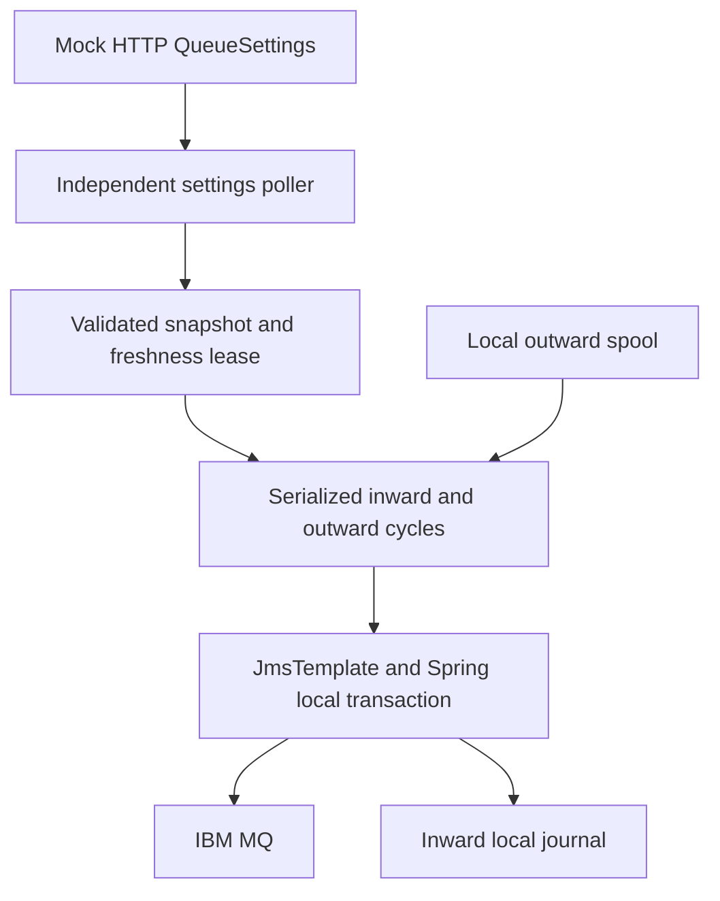
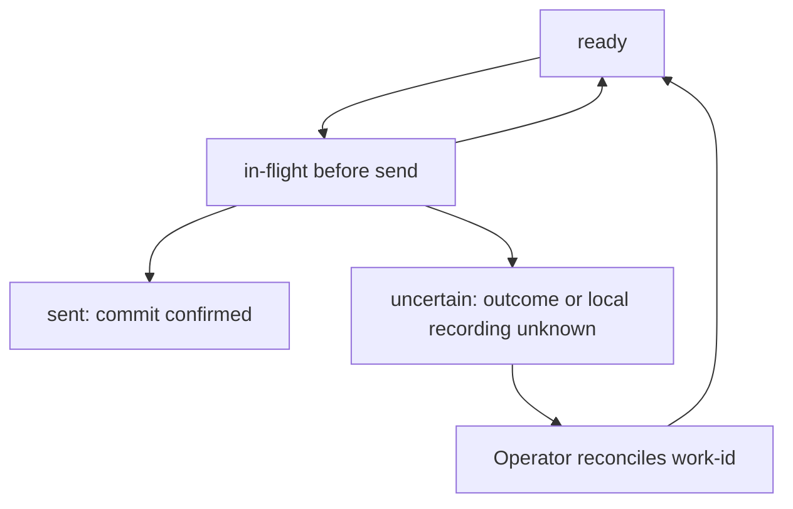

# Architecture, transactions and recovery

## Runtime topology



Settings HTTP requests run on `settings-poller`, separately from the single `mq-cycles` executor. Inward/outward never overlap in this implementation. A long inward cycle can delay outward, but cannot block polling settings. Receive is explicit and blocking with a bounded per-receive timeout, not a push listener. Each loop uses fixed delay after completion; no accumulated catch-up work or overlapping cycle is scheduled.

## Class responsibilities

| Class                    | Responsibility                                                                   |
|--------------------------|----------------------------------------------------------------------------------|
| `QueueSettingsClient`    | JDK HTTP client, request timeout, HTTP 200 and JSON validation                   |
| `SettingsRegistry`       | Immutable snapshot, monotonic revision, generation and max-age lease             |
| `ReschedulingLoop`       | Coalesced wake requests, dynamic fixed delay, stop without overlapping execution |
| `AgentRuntime`           | Polling, per-cycle caps, settings gates, retry delay and outbox outcome handling |
| `IbmMqOperationsFactory` | Fresh provider factory + Spring `SingleConnectionFactory` for each cycle         |
| `SpringMqOperations`     | JmsTemplate, per-message TransactionTemplate, send-outcome classification        |
| `FileOutbox`             | Local claim, sent, retry, uncertain, explicit replay                             |
| `InwardJournal`          | Text handler, stable-ID idempotent journal and deliberate rejection prefix       |
| `AgentLease`             | File lock allowing one scheduler for a data directory                            |
| `LabRunner`              | Manual commands, scheduler entry points and independent shell actions            |

## Who opens/closes the connection?

For one cycle the application constructs a Spring `SingleConnectionFactory` around an immutable IBM MQ factory. Spring lazily opens one physical connection when an actual JMS operation occurs, and shares it across that cycle's sessions. `JmsTransactionManager` acquires/releases a session per message. Scope close calls the Spring factory's `destroy()`, closing the physical connection. An outward cycle with no ready work need not open a physical MQ connection at all.

The application chooses the lifecycle scope and transaction boundary; Spring performs the JMS resource and transaction operations inside them. IBM automatic reconnect and Spring reconnect-on-exception are disabled deliberately. After a cycle fails, its scope closes, and the next eligible cycle constructs a fresh factory from the latest settings. No old endpoint is silently retained in a long-lived connection cache. Shell is the explicit exception: it reuses one scope for its commands until quit; restart shell after transport failure.

## Per-message transaction, not a batch transaction

Both JmsTemplate and JmsTransactionManager use **the exact same Spring ConnectionFactory instance**. The template is transacted; the transaction manager binds the session to the worker thread. `TransactionTemplate.execute` wraps the receive **and the handler**:

```java
transactions.execute(status -> {
    Message message = jms.receive(destination);
    
    if (message == null) 
        return Optional.empty();
    ReceivedMessage decoded = decode(message);
    handler.accept(decoded);        // must succeed before commit
    
    if (rollbackRequested) 
        status.setRollbackOnly();
    
    return Optional.of(decoded);
});
// Spring commit/rollback finishes here
```

This is schematic; see `SpringMqOperations` for actual type/size checks and exception handling. There are no direct application calls to JMS `commit`, `rollback` or native MQ `backout`.

| Event                                     | Local JMS transaction outcome                               |
|-------------------------------------------|-------------------------------------------------------------|
| Send succeeds; commit succeeds            | Persistent publication confirmed to caller                  |
| Receive handler succeeds; commit succeeds | Message removal confirmed                                   |
| Handler throws a runtime exception        | Spring rolls back; MQ can redeliver                         |
| Command requests rollback/backout         | `TransactionStatus.setRollbackOnly()`, then Spring rollback |
| Batch message 4 fails after 1–3 committed | 1–3 remain committed; cycle stops at 4                      |
| Connection fails before sending           | Work can remain ready for a future cycle                    |
| Commit reply is lost after attempted send | Outcome may be unknown; quarantine for review               |

With counts `inward=5` / `outward=7`, the respective cycles perform **at most 5 / 7 independent message transactions** on a shared connection. Receive stops on the first empty result; outward stops when ready work runs out. Error stops the cycle. A count does not guarantee exactly that many messages or promise all-or-nothing atomicity.

Using JmsTemplate outside a managed transaction is different. `sessionTransacted=true` can locally complete one template operation, but a `receive()` returning before later business processing cannot roll back that receive because the later handler failed. Likewise a loop of standalone sends does not become one transaction automatically. We therefore supply explicit TransactionTemplate boundaries around processing.

An atomic **whole-batch** variant would wrap the entire receive/send loop in one TransactionTemplate callback using that same factory/session. Then one failure would roll back all messages in that batch. It would hold locks/resources longer and require careful empty-receive and poison-message policy. That variant is **not implemented here**. Do not add manual `Session.commit()` inside a Spring-managed transaction. For transactional consume-and-send in the same MQ queue manager, both operations must run inside the same boundary. Cross-resource databases/HTTP/files need their own durable consistency design; local JmsTransactionManager is not XA.

## Remote changes during failure or work

A complete validated snapshot is accepted atomically. Newer revision invalidates the old generation and wakes cycles. Before each new message, a cycle checks that its generation is still current, enabled and fresh. An already running transaction finishes against its original settings; the next message is gated. Changes do not interrupt a blocked provider connection call or attempt to undo a successful earlier commit.

On startup without valid settings: no MQ work. On HTTP failure/invalid revision/invalid values: retain the last valid snapshot without refreshing its age. On lease expiry: pause new MQ messages, continue polling. On valid response: resume automatically if enabled. Receiving an identical valid revision renews the lease without forcing cycle churn. Mock revision rollback is rejected until a newer revision is supplied or the agent is deliberately restarted.

A connection error does not disable the HTTP poller. Correcting host, port, channel, queue names or counts changes the next scope. `failure-retry-ms` is a fixed delay after failure returns; it is not an IBM TCP connect timeout. A stuck MQ provider call delays both MQ directions but the separate poller still runs.

## Sending, retries and uncertainty



`RETRYABLE` means the transaction never reached the send callback, or Spring reports a confirmed rollback. `UNKNOWN` means an attempted send ended without confirmed rollback/normal committed return. The lab conservatively avoids repeating UNKNOWN work. An UNKNOWN send also poisons that connection scope, preventing a later shell command from blindly repeating on the same ambiguous scope.

The scheduled payload is JSON with a stable `work-id` UUID and `payload`. Sent files also record `mq-message-id` and confirmed commit. Reconcile by work-id against the queue or downstream processing records; the CLI browse command counts selected messages and does not search payload UUIDs. `requeue` is an explicit operator action after reconciliation. This policy favors avoiding blind duplicates; uncertain work will not automatically resume on reconnection. Other ready work resumes normally.

After process crash, `in-flight` work becomes `uncertain` only when an agent/once command obtains the data-directory lock. CLI enqueue/status do not recover another running agent's claims. Ordering is filename order, not an application FIFO contract. The spool uses atomic rename on one filesystem and does not perform fsync or promise power-loss durability. It is not an HA or distributed outbox.

## Receiving, rollback and poison messages

The handler writes a journal keyed by IBM JMSMessageID before MQ commit. Redelivery with the same ID and text reuses that file. File storage and MQ do not commit atomically; a record may exist for a transaction whose MQ commit failed. Stable-ID journal idempotency demonstrates safe repeated local handling under normal process failures, not end-to-end exactly-once processing or a database-backed inbox.

A text beginning with `FAIL:` causes deliberate rejection and rollback. The runtime stops the cycle and delays retry. It does not move poison messages automatically to a backout queue. MQ's backout count/BOQ attributes by themselves do not cause this synchronous application to relocate a message. Add a business-specific retry/dead-letter policy before production. Manual receive uses its own print handler and can explicitly consume a test poison message after pausing the scheduler.

`receive-timeout-ms=0` maps to Spring `RECEIVE_TIMEOUT_NO_WAIT`, **not JMS receive(0)** (which waits indefinitely). Positive values wait at most that timeout for an individual receive under normal provider behavior. Handler time and transport calls are additional.

## Shutdown

Ctrl+C triggers Spring bean destruction. The runtime stops scheduling new work and marks cycles closed; an in-progress operation can finish and record its outcome. Executor shutdown waits, then interrupts if necessary, but an MQ provider call may not obey interruption immediately. A hard kill can leave in-flight work for uncertainty recovery. MQ transactions and file journals must be reconciled after forced termination.

References: [Spring JMS usage](https://docs.spring.io/spring-framework/reference/integration/jms/using.html), [synchronous receive](https://docs.spring.io/spring-framework/reference/integration/jms/receiving.html), [JmsTransactionManager](https://docs.spring.io/spring-framework/docs/current/javadoc-api/org/springframework/jms/connection/JmsTransactionManager.html), [SingleConnectionFactory](https://docs.spring.io/spring-framework/docs/current/javadoc-api/org/springframework/jms/connection/SingleConnectionFactory.html).
